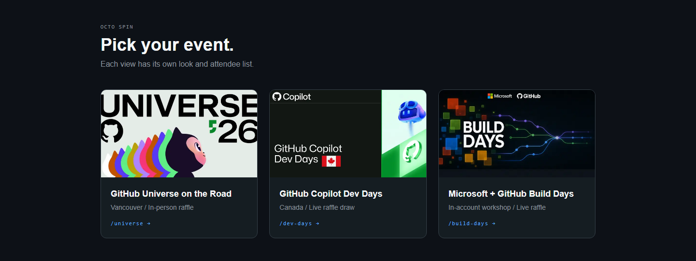
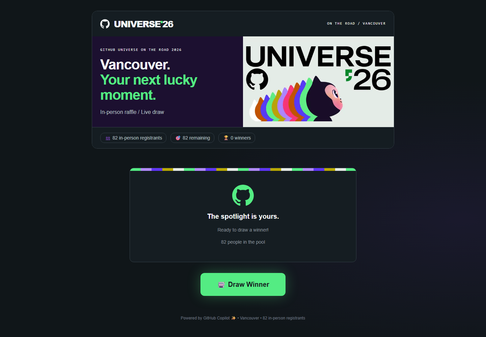
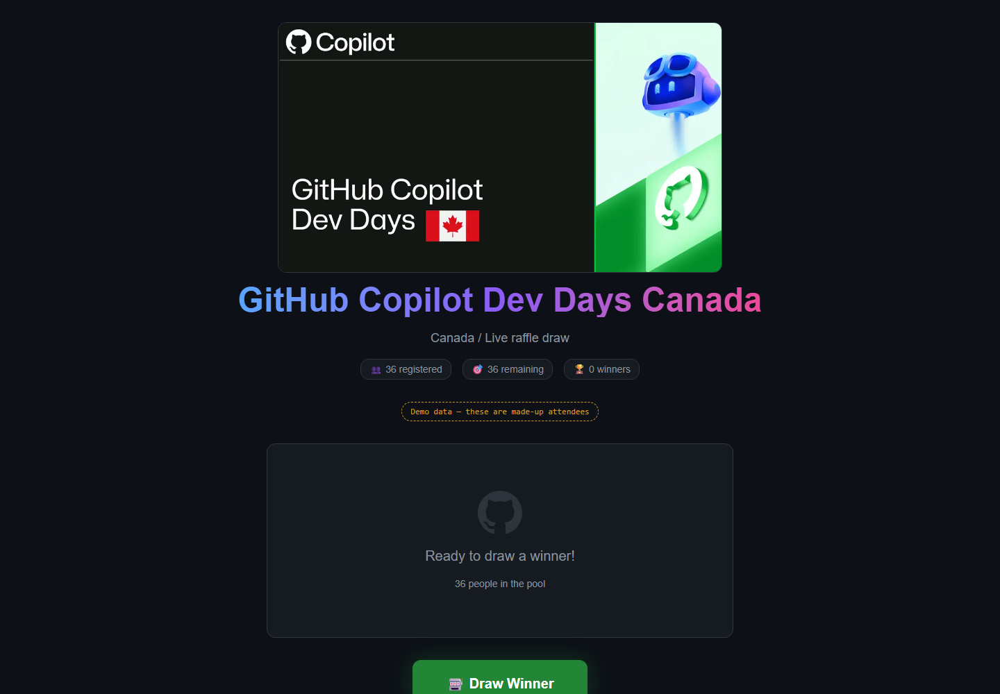
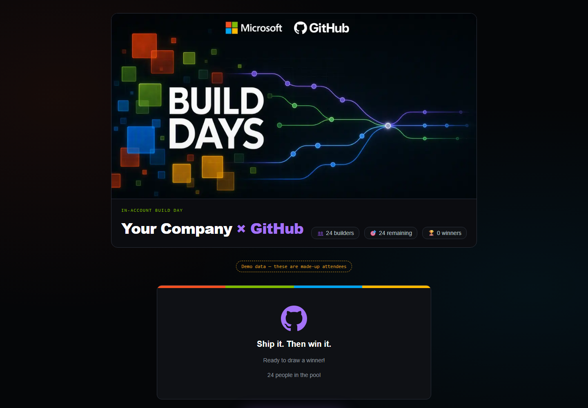

# 🎰 GitHub Copilot Dev Days — Raffle App

A live raffle draw app for **GitHub Copilot Dev Days** events. Chapter leads can plug in their own attendee list and run a fun, animated raffle during their event.

Built with Next.js, Tailwind CSS, and ✨ vibes.

## Views

Octo Spin has three saved event views. Open `/` to pick one.

| Route | View | Look |
|-------|------|------|
| `/universe` | GitHub Universe on the Road | Universe '26 charcoal, green, and violet theme (Vancouver) |
| `/dev-days` | GitHub Copilot Dev Days | Original GitHub-dark look with the Dev Days banner |
| `/build-days` | In-account Build Days | Microsoft × GitHub look with the Build Days banner |

Each view reads its own private list from `data/<view>.json` (`data/universe.json`, `data/dev-days.json`, `data/build-days.json`). If that file is missing, the view uses demo data from `src/data/demo/<view>.json` and shows a "Demo data" badge.

- Set the Build Days customer name in `customerName` in `src/config/events.ts`.
- Pages are built statically. After you change a data file, rebuild (`npm run build -- --webpack`) or use `npm run dev`.
- Run a local preview with `npm run dev -- --webpack --port 3124`.

### Screenshots

**Home picker (`/`)**



| Universe on the Road (`/universe`) | Dev Days (`/dev-days`) | Build Days (`/build-days`) |
|---|---|---|
|  |  |  |

## Quick Start

```bash
# 1. Clone the repo
git clone <repo-url> && cd raffle-app

# 2. Install dependencies
npm install

# 3. Add your attendee data (see below)

# 4. Run the app
npm run dev
```

Open [http://localhost:3000](http://localhost:3000) to see the raffle.

## 📋 Setting Up Your Attendee Data

> **⚠️ Important:** The `data/` folder is gitignored. Never commit attendee data — it contains personal information (names, emails, GitHub handles).

### Step 1: Export from Luma

1. Go to your Luma event dashboard
2. Export the guest list as CSV
3. Save the CSV to `data/` for your reference (optional)

### Step 2: Create `data/<view>.json`

Create `data/universe.json`, `data/dev-days.json`, or `data/build-days.json` with this format:

```json
[
  {
    "name": "Jane Doe",
    "github": "janedoe",
    "company": "Acme Corp"
  },
  {
    "name": "John Smith",
    "github": "NA",
    "company": "Contoso Ltd"
  }
]
```

Each attendee needs three fields:

| Field     | Description                          | Notes                                      |
|-----------|--------------------------------------|---------------------------------------------|
| `name`    | Full name                            | Required                                    |
| `github`  | GitHub username (without `@`)        | Use `"NA"`, `"none"`, or `""` if unknown    |
| `company` | Company or organization              | Use `""` if unknown                         |

> **Tip:** See [`attendees.example.json`](./attendees.example.json) in the project root for a working template. Copy it to `data/<view>.json` and replace with real data.

### Converting Luma CSV → JSON

The Luma CSV export includes columns like `name`, `What is your GitHub username?`, and `What company do you work for?`. You'll need to map these to the JSON format above.

You can do this manually, with a script, or ask GitHub Copilot to help you write a quick converter!

## 🎨 Customizing for Your Event

Edit `src/config/events.ts` to change each view's title, tagline, banner, labels, and the Build Days `customerName`. View-specific layouts live in `src/components/*-raffle.tsx`; the shared draw logic is in `src/components/raffle.tsx`.

## Project Structure

```
raffle-app/
├── data/                      # ⛔ Gitignored — real attendee lists (<view>.json)
├── attendees.example.json     # ✅ Template showing expected format
├── public/                    # Event banners
├── src/
│   ├── app/                   # Home picker and /universe, /dev-days, /build-days routes
│   ├── components/            # Shared raffle stage and per-view layouts
│   ├── config/events.ts       # Per-view text and settings
│   ├── data/demo/             # ✅ Committed fake demo attendees
│   └── lib/                   # Attendee helpers and data loader
└── README.md
```

## Tech Stack

- [Next.js](https://nextjs.org) — React framework
- [Tailwind CSS](https://tailwindcss.com) — Styling
- TypeScript — Type safety
