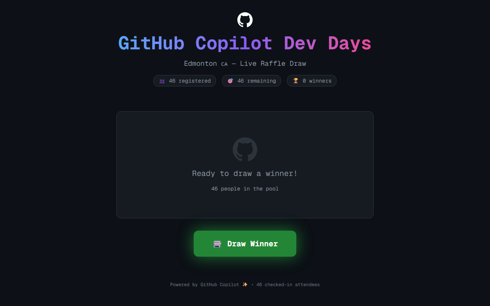
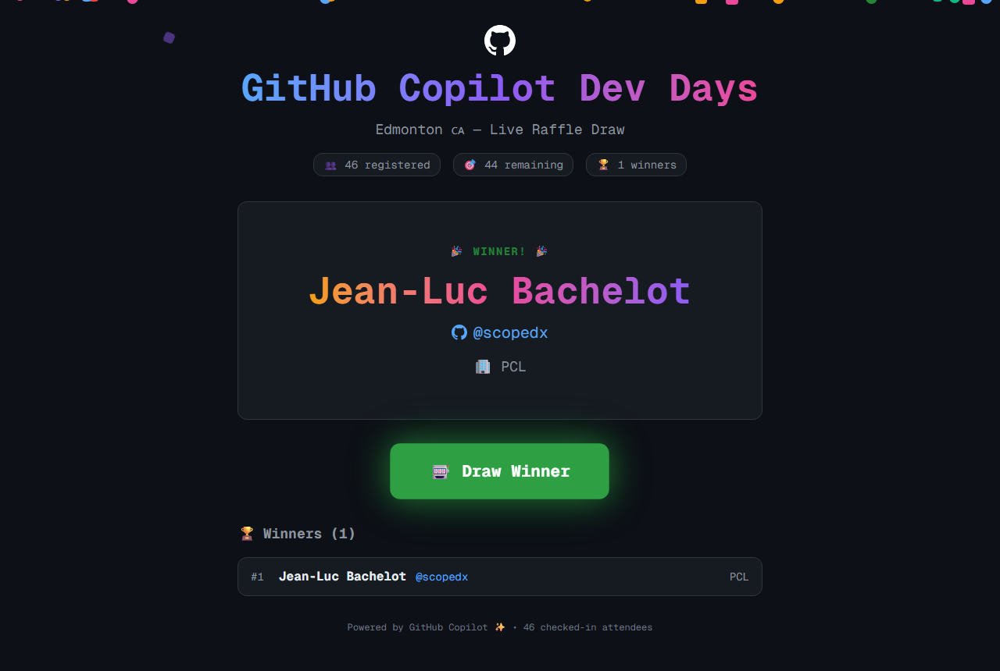

# 🎰 GitHub Copilot Dev Days — Raffle App

A live raffle draw app for **GitHub Copilot Dev Days** events. Chapter leads can plug in their own attendee list and run a fun, animated raffle during their event.

Built with Next.js, Tailwind CSS, and ✨ vibes.

| Landing | Winner Drawn |
|---------|-------------|
|  |  |

## Quick Start

```bash
# 1. Clone the repo
git clone <repo-url> && cd raffle-app

# 2. Install dependencies
npm install

# 3. Add your attendee data (see below)

# 4. Run the app
npm run dev
```

Open [http://localhost:3000](http://localhost:3000) to see the raffle.

## 📋 Setting Up Your Attendee Data

> **⚠️ Important:** The `data/` folder is gitignored. Never commit attendee data — it contains personal information (names, emails, GitHub handles).

### Step 1: Export from Luma

1. Go to your Luma event dashboard
2. Export the guest list as CSV
3. Save the CSV to `data/` for your reference (optional)

### Step 2: Create `data/attendees.json`

Create a file at `data/attendees.json` with this format:

```json
[
  {
    "name": "Jane Doe",
    "github": "janedoe",
    "company": "Acme Corp"
  },
  {
    "name": "John Smith",
    "github": "NA",
    "company": "Contoso Ltd"
  }
]
```

Each attendee needs three fields:

| Field     | Description                          | Notes                                      |
|-----------|--------------------------------------|---------------------------------------------|
| `name`    | Full name                            | Required                                    |
| `github`  | GitHub username (without `@`)        | Use `"NA"`, `"none"`, or `""` if unknown    |
| `company` | Company or organization              | Use `""` if unknown                         |

> **Tip:** See [`attendees.example.json`](./attendees.example.json) in the project root for a working template. Copy it to `data/attendees.json` and replace with real data.

### Converting Luma CSV → JSON

The Luma CSV export includes columns like `name`, `What is your GitHub username?`, and `What company do you work for?`. You'll need to map these to the JSON format above.

You can do this manually, with a script, or ask GitHub Copilot to help you write a quick converter!

## 🎨 Customizing for Your Event

Edit `src/app/page.tsx` to update:

- **Event title** — change the `<h1>` text (line ~177)
- **City/chapter** — change the subtitle `<p>` (line ~179)

## Project Structure

```
raffle-app/
├── data/                      # ⛔ Gitignored — your attendee data goes here
│   └── attendees.json         # Your event's attendee list (create this)
├── attendees.example.json     # ✅ Committed — template showing expected format
├── src/app/
│   ├── page.tsx               # Main raffle UI
│   ├── globals.css            # Styles & animations
│   └── layout.tsx             # App layout
├── .gitignore                 # Ensures /data is never committed
└── README.md                  # You are here
```

## ☁️ Deploying to Azure

This app ships with a GitHub Actions workflow that deploys to **Azure App Service** on every push to `main`.

### Step 1: Create an Azure App Service

1. In the [Azure Portal](https://portal.azure.com), create a **Web App**
2. Runtime stack: **Node 20 LTS**
3. OS: **Linux**

### Step 2: Get the Publish Profile

1. Go to your App Service → **Deployment Center** → **Manage publish profile**
2. Download the `.PublishSettings` file
3. Copy its entire XML content

### Step 3: Add GitHub Secrets

In your repo → **Settings → Secrets and variables → Actions**, add:

| Secret | Value |
|--------|-------|
| `AZURE_WEBAPP_NAME` | Your App Service name (e.g., `octo-spin`) |
| `AZURE_WEBAPP_PUBLISH_PROFILE` | The full XML from the `.PublishSettings` file |

### Step 4: Push to `main`

The workflow (`.github/workflows/azure-deploy.yml`) triggers automatically on push to `main`. You can also trigger it manually via the **Actions** tab.

> **Note:** The build uses a `prebuild` script that copies `attendees.example.json` → `data/attendees.json` if no real data exists. This means CI builds always succeed with demo data. To use real attendee data in production, upload `data/attendees.json` to your App Service via SSH/FTPS, or rebuild with the file present.

## Tech Stack

- [Next.js](https://nextjs.org) — React framework
- [Tailwind CSS](https://tailwindcss.com) — Styling
- TypeScript — Type safety
